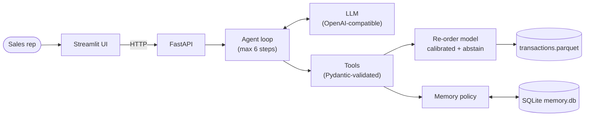

# ReorderPilot

An LLM sales assistant for B2B sellers. It predicts which products each customer will **re-order in the next 30 days**,
explains why, **abstains when unsure**, and **learns from the sales rep's feedback** through persistent memory
(e.g. "declined: overstocked" → that product is not offered again for 30 days).

Built on the public UCI *Online Retail II* dataset (a UK gift wholesaler, 2009-2011). The system runs at a simulated
"today" of **2011-11-01** (`AS_OF_DATE`), so every result is reproducible.

> Numbers marked **TODO(numbers)** are filled from `eval/results/` after the final evaluation run.

---

## 1. What it does, for whom, why this topic

**User:** a B2B sales rep with hundreds of wholesale customers who doesn't know whom to call today or what to offer.

**Pain:** untargeted calls; offering items the customer just declined; nothing remembered between calls.

**What ReorderPilot does:**
- ranks customers by expected re-order value ("who should I call today?");
- gives a per-customer briefing: top products with calibrated probabilities, a plain-language reason for each,
  caveats and a short suggested message;
- abstains ("not enough history") instead of guessing for new or low-confidence customers;
- records the rep's feedback and applies **deterministic rules** to it: a declined-overstocked product is
  suppressed for 30 days, and the suppression is visible and auditable.

**Why this topic:** it combines a classic ML problem (tabular prediction with a temporal split and honest baselines)
with an LLM agent. The agent never makes up numbers: every product and probability comes from a tool.

## 2. Choices and alternatives

Full reasoning is in [DECISIONS.md](DECISIONS.md). The most important ones:

| Decision | Chosen | Alternatives considered | Why |
|---|---|---|---|
| Model | HistGradientBoosting + Platt calibration | logistic regression, rule baselines only | handles missing values natively, beats baselines on PR-AUC |
| Evaluation split | temporal (train ≤ 2011-06, valid Jul-Aug, test Sep-Nov) | random split | random split leaks the future |
| Uncertainty | abstain (cold start < 3 orders, or below threshold tau) | always answer | a wrong confident offer costs the rep's trust |
| Memory | SQLite + rules in code | vector DB, LLM decides | small data, auditable, testable |
| Agent | hand-written loop (~150 lines) | LangChain / agent frameworks | every step explainable, easy to test with a fake LLM |
| LLM | any OpenAI-compatible API (Groq `gpt-oss-120b` by default) | one vendor SDK | provider-agnostic; free tier for development |
| Product matching | word coverage over descriptions | fuzzy WRatio | WRatio matched wrong products on short queries (D9) |

## 3. How it works



The agent has 6 tools: `list_customers_due`, `predict_reorder`, `get_customer_history`, `read_memory`,
`write_memory`, `find_product`. The policy that turns feedback into suppression lives in `memory/store.py`, not in
the prompt. The detailed component diagram, the sequence of one chat turn and the feedback loop are in
[docs/architecture.md](docs/architecture.md).

## 4. How I got here (problems met and fixes)

- **Duplicate rows:** the two sheets of the xlsx overlap by 9 days (≈34k duplicate rows). Found by checking row counts,
  fixed in cleaning (DECISIONS D3).
- **Calibration vs season:** Platt scaling fitted on Jul-Aug slightly *hurt* Brier on the Sep-Nov test months
  (Christmas season re-orders more). Kept and documented instead of tuning on test.
- **LLM rate limits:** the Groq free tier allows ~8K tokens/min; one briefing costs ~5-6K. Added a client-side rate
  limiter, retry on HTTP 429 honouring `retry-after`, and an on-disk response cache so eval reruns are free.
- **Wrong product resolved:** fuzzy matching (WRatio) picked wrong items for short names; replaced with word coverage (D9).
- **My own metric bugs:** a non-ASCII dash (U+2011) and substring product names changed eval results. Lesson: read
  raw answers before trusting an automatic metric.
- **Prompt scope:** "Who should I call today?" was once refused as out-of-scope (eval D, d01). A prompt v2 is proposed.
- <!-- TODO(human): add any problem you hit yourself that is not in the list above -->

## 5. How I verified it

All numbers below come from running the scripts in `eval/`; raw outputs are in `eval/results/`.

### A. Model vs baselines (test cutoffs 2011-09-01, 10-01, 11-01)

<!-- TODO(numbers): copy from eval/results/model_eval.md -->

| method | precision@5 | recall@5 | hit_rate@5 | PR-AUC | ROC-AUC | Brier |
|---|---|---|---|---|---|---|
| B1 repeat last order | TODO | TODO | TODO | TODO | TODO | n/a |
| B2 most frequent | TODO | TODO | TODO | TODO | TODO | n/a |
| B3 overdue | TODO | TODO | TODO | TODO | TODO | n/a |
| **HGB calibrated** | TODO | TODO | TODO | TODO | TODO | TODO |

- Abstention at tau = TODO(numbers): coverage TODO% of customers with history, precision of recommended items TODO.
- Plots: [calibration](eval/results/calibration.png), [abstention curve](eval/results/abstention_curve.png).

### B. Memory ablation (does feedback stop repeat offers?)

Each test customer's top-1 product is logged as `declined / overstocked`, then the agent is asked for a briefing.

<!-- TODO(numbers): copy from eval/results/memory_eval.md (state n and model) -->

| metric (n = TODO) | memory ON | memory OFF |
|---|---|---|
| repeat-recommendation rate of the declined item | TODO | TODO |
| answer mentions the suppression | TODO | TODO |

### C. Feedback extraction (rep sentence → structured `write_memory`)

<!-- TODO(numbers): copy from eval/results/agent_eval.md -->
All 4 fields exact: TODO% (n = TODO). Per field: customer_id TODO, outcome TODO, stock_code TODO, reason TODO.

### D. Agent behaviour scenarios

<!-- TODO(numbers): copy from eval/results/agent_eval.md -->
Pass rate TODO% (n = TODO) across: due-customers, briefing, explain-why, log-feedback, cold-start abstention,
out-of-scope, malicious-note injection. Checks: expected tools called, no product absent from tool outputs,
abstention respected.

### Tests

`pytest -q`: TODO(numbers) tests, including a leakage test (future rows change no feature), memory policy rules,
API endpoints, the agent loop with a scripted fake LLM (malformed JSON retry, max steps), a malicious-note
injection test and headless UI tests.

### Limitations (honest)

- One dataset, one retailer, historical data; the "today" is simulated.
- Test months are the Christmas season: calibration fitted on summer months is slightly off.
- Cold-start customers (< 3 orders) always get an abstention: no recommendation for new customers.
- Agent evals B-D were run on small samples because of the free-tier token limit. TODO(numbers): final n.
- Automatic checks miss some errors seen in manual review (e.g. a wrong date in one answer, an invented
  "back in stock" claim). The no-hallucination check covers products, not every sentence.
- The LLM sometimes skips `read_memory`. Suppression still works, because it is applied inside `predict_reorder`.

## 6. What I'd do next

- Prompt v2 (scope + outcome definitions), then rerun evals B-D on the full sets.
- Recommend *new* products (cross-sell), not only re-orders; a cold-start model for new customers.
- Learn suppression lengths from data instead of fixed 30/90 days.
- Out of scope for this project: authentication, multi-tenant, real CRM integration, voice, cloud deployment,
  Postgres instead of SQLite for many concurrent users.

## How I worked with AI agents

The project was built with Claude Code agents working in parallel git worktrees, each limited to one area ("lane"):
scaffold + contracts (T0), data + model (A), memory + API (B), agent (C), UI + packaging + docs (D).
`SPEC.md` and `api/schemas.py` were the shared contract, so lanes could work in parallel. Every agent had to write
tests, log decisions in `DECISIONS.md` and explain its work in `docs/LEARNING_LOG.md`.

<!-- TODO(human): write this part in your own words. Suggested points:
- what you reviewed line by line and what you only skimmed;
- concrete corrections you made (e.g. DECISIONS entries you asked to change, metric bugs found in review);
- what you would not delegate next time. -->

---

## Run it

Requirements: Python 3.11+ (tested on 3.12), an API key for an OpenAI-compatible LLM (Groq free tier works),
the dataset (below). Optional: Docker.

### 1. Get the data

Download *Online Retail II* from the [UCI page](https://archive.ics.uci.edu/dataset/502/online+retail+ii)
and put the `.xlsx` (or a `.csv`) into `data/raw/`. The data folder can be elsewhere: set `REORDERPILOT_DATA_DIR`.

### 2a. Local run

```bash
python -m venv .venv
.venv\Scripts\activate                 # Windows   (Linux/macOS: source .venv/bin/activate)
pip install -r requirements.txt
pip install -e .
cp .env.example .env                   # then set LLM_API_KEY (and LANGSMITH_API_KEY, or LANGSMITH_TRACING=false)

python -m reorderpilot.data.loader     # raw xlsx -> data/processed/transactions.parquet (a few minutes)
python -m reorderpilot.model.train     # -> artifacts/model.joblib + artifacts/metrics.json
pytest -q                              # tests (use temp files, never the real memory.db)

uvicorn reorderpilot.api.main:app --reload       # terminal 1 -> http://localhost:8000/docs
streamlit run app/streamlit_app.py               # terminal 2 -> http://localhost:8501
```

### 2b. Docker run

```bash
cp .env.example .env                   # set LLM_API_KEY; dataset already in ./data/raw/
docker compose build
docker compose run --rm api python -m reorderpilot.data.loader
docker compose run --rm api python -m reorderpilot.model.train
docker compose up                      # API http://localhost:8000/docs, UI http://localhost:8501
```

`./data` and `./artifacts` are mounted as volumes: the image contains code only, and the data and model stay on
your disk.

### Evaluation

```bash
python eval/run_model_eval.py
python eval/run_memory_eval.py --limit 5     # LLM evals accept --limit and --model (token budget)
python eval/run_agent_eval.py --limit 5
```

A 4-5 minute demo walkthrough is in [docs/DEMO_SCRIPT.md](docs/DEMO_SCRIPT.md).

## Data and attribution

This project uses the **Online Retail II** dataset:

- Source: UCI Machine Learning Repository, <https://archive.ics.uci.edu/dataset/502/online+retail+ii>
- Author: Daqing Chen. DOI: 10.24432/C5CG6D <!-- TODO(human): verify author list and DOI on the UCI page -->
- License: [Creative Commons Attribution 4.0 International (CC BY 4.0)](https://creativecommons.org/licenses/by/4.0/)

No raw or processed data is redistributed in this repository: `data/` is gitignored, and the Docker image does not
contain it. Changes made to the data (cleaning rules) are described in `src/reorderpilot/data/clean.py` and
DECISIONS D3.
