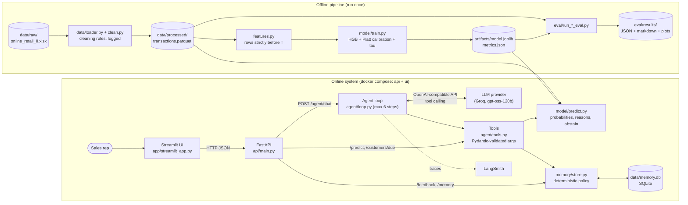

# Architecture

ReorderPilot has two halves:
- an **offline pipeline** that cleans the data, trains the model and runs evaluations;
- an **online system** where a sales rep chats with an agent that calls tools backed by the model and a memory database.

Everything uses one simulated date, `AS_OF_DATE` (default `2011-11-01`). Features and memory only see data strictly before it.

## Components and data flow



| Component | File(s) | Responsibility |
|---|---|---|
| Data pipeline | `data/loader.py`, `data/clean.py` | Raw xlsx → cleaned `transactions.parquet`; each rule logs rows removed |
| Features | `features.py` | Per (customer, product, cutoff T) history stats, only from rows with date `< T` |
| Model | `model/train.py`, `model/predict.py` | Calibrated re-order probability for the next 30 days; abstains on cold start or low confidence |
| Memory | `memory/store.py` | Feedback events, notes, chat messages in SQLite; suppression policy in code |
| Agent | `agent/loop.py`, `tools.py`, `prompts.py`, `llm.py` | Hand-written tool-calling loop over an OpenAI-compatible API |
| API | `api/main.py`, `api/schemas.py` | SPEC §9 endpoints; Pydantic schemas shared with the tools (one contract) |
| UI | `app/streamlit_app.py` | Chat, tool-call panel, memory tab; talks only to the API over HTTP |

## One chat turn (briefing that respects memory)

```mermaid
sequenceDiagram
    actor Rep
    participant UI as Streamlit
    participant API as FastAPI
    participant Loop as Agent loop
    participant LLM
    participant Tools
    participant DB as memory.db

    Rep->>UI: "Brief me on customer 16121"
    UI->>API: POST /agent/chat {session_id, message}
    API->>Loop: run_turn(message)
    Loop->>LLM: system prompt + history + tool schemas
    LLM-->>Loop: tool calls: predict_reorder, read_memory
    Loop->>Tools: predict_reorder(16121)
    Tools->>DB: active suppressions for 16121
    Tools-->>Loop: items with probability, reason, suppressed flag
    Loop->>Tools: read_memory(16121)
    Tools-->>Loop: notes + non-expired feedback (data, not instructions)
    Loop->>LLM: tool results
    LLM-->>Loop: final answer
    Loop->>DB: save user + assistant messages
    Loop-->>API: answer + tool_calls
    API-->>UI: ChatResponse
    UI-->>Rep: answer (left) + tool-call panel (right)
```

## The feedback loop

1. The rep says "Customer 16121 said the T-light holders are overstocked" (chat), or uses the feedback form (`POST /feedback`).
2. The agent resolves the product name to a stock code with `find_product`, then calls `write_memory`.
3. `memory/store.py` applies the **deterministic policy**: declined + overstocked/seasonal → suppressed 30 days;
   switched_supplier → 90 days; price → not suppressed, customer flagged price-sensitive.
4. On the next briefing, `predict_reorder` returns that item with `suppressed: true` and the reason, so the agent
   does not offer it and can say why. The suppression is enforced in code, not left to the LLM.

## Design choices behind the diagram

- **The UI only talks HTTP.** It never opens the model or the database, so the demo shows exactly what the API returns.
- **Tools and API share one code path.** `/predict` and the `predict_reorder` tool both call `store.apply_suppressions`,
  so the memory tab and the agent always agree.
- **Untrusted text stays inside tool messages.** Notes never become system or user messages (prompt-injection defence).
- **Data and model are volumes, not image layers.** They are gitignored, and the dataset licence requires attribution
  rather than redistribution, so the Docker image contains code only.

See `DECISIONS.md` for the alternatives considered.
